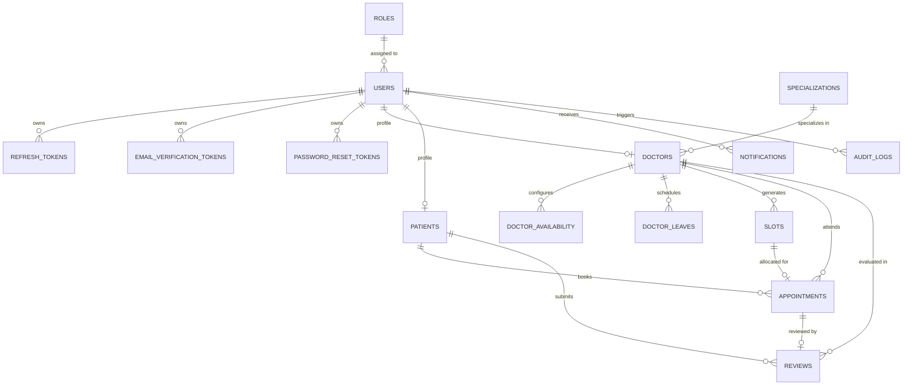

# 🏥 MediBook — Hospital Appointment Booking System

[](https://spring.io/projects/spring-boot)
[](https://reactjs.org/)
[](https://neon.tech)
[](https://firebase.google.com/)
[](https://tailwindcss.com/)
[](LICENSE)

**MediBook** is a production-grade, enterprise full-stack Hospital Appointment Booking & Healthcare Management Platform. Built with **Spring Boot 3.4**, **React 18 + Vite**, **Neon Serverless PostgreSQL**, **Firebase Authentication**, and **Flyway**, MediBook guarantees zero double-booking concurrency safety, seamless Google Sign-In, dynamic doctor slot scheduling, and role-based portals for Patients, Doctors, and Administrators.

---

## 🚀 Live Demo & Deployment

| Service | Live URL | Hosting Platform | Status |
| :--- | :--- | :--- | :--- |
| **🌐 Web Application (Frontend)** | **[https://medibook-frontend-qxny.onrender.com](https://medibook-frontend-qxny.onrender.com)** | Render (Global CDN) |  |
| **⚡ REST API (Backend)** | **[https://medibook-backend-uyz7.onrender.com](https://medibook-backend-uyz7.onrender.com)** | Render (Docker / Java 17) |  |
| **🐘 Database** | Neon Serverless PostgreSQL 16 | Neon Cloud |  |

> 🔗 **Explore Live Demo**: **[https://medibook-frontend-qxny.onrender.com](https://medibook-frontend-qxny.onrender.com)**  
> *Supports instant Google Sign-In or test login using any of the demo accounts below.*

### 🔑 Demo Accounts for Testing

| Role | Email | Password | Access & Capabilities |
| :--- | :--- | :--- | :--- |
| **Admin** | `admin@medibook.com` | `Admin@123` | Doctor verification, user management, audit logs, revenue metrics |
| **Doctor** | `doctor.sarah@medibook.com` | `Admin@123` | Appointment management, slot generation, leaves, consultation notes |
| **Patient** | `patient.john@medibook.com` | `Admin@123` | Doctor search, booking wizard, appointment history, reviews |
| **New User** | Any Google Account | *1-Click Google Sign-In* | Instant signup & automatic Neon profile sync |

---

## 🌟 Key Highlights & Features

- 🔒 **Zero Double-Booking Guarantee**: Concurrency-safe slot reservations combining PostgreSQL database constraints, Pessimistic Locking (`PESSIMISTIC_WRITE`), and JPA `@Version` Optimistic locking.
- 🔑 **Dual Authentication (Firebase + JWT)**:
  - 1-Click **Google Sign-In** with automatic Neon profile synchronization.
  - Real-time **Firebase Email/Password Signup** with genuine verification emails.
  - Short-lived JWT Access Tokens (15 min) + secure HTTP-only Refresh Token rotation (7 days).
- 👨‍⚕️ **Doctor Discovery & Filtering**: Search through verified specialists by specialization, city, consultation fee, and star ratings.
- 📅 **Dynamic Appointment Scheduling**: Doctors can configure weekly working hours (e.g. Mon–Sat), schedule leaves, and generate 30-day slot windows with 1 click.
- 📝 **Patient Health Records**: Patients can manage their blood group, emergency contacts, medical history, and view past consultation notes.
- ⭐ **Verified Reviews & Ratings**: Only patients with completed consultations can leave authentic 1–5 star reviews and clinical feedback.
- 🔔 **In-App & Email Notifications**: Automatic notifications upon booking confirmation, rescheduling, and cancellation.
- 🎨 **Modern Responsive UI**: Custom Teal/Navy aesthetics with light & dark mode support, glassmorphism cards, and fluid animations.

---

## 📐 Entity Relationship Diagram (ERD)



---

## 🛠️ Technology Stack

| Layer | Technologies |
| :--- | :--- |
| **Backend** | Java 17+, Spring Boot 3.4, Spring Security 6, Spring Data JPA, Hibernate ORM 6 |
| **Database** | Neon Serverless PostgreSQL 16, Flyway Database Migrations, HikariCP |
| **Authentication** | Firebase Authentication (Google Sign-In & Email), JJWT (HS384) |
| **Frontend** | React 18, Vite, React Router v6, Tailwind CSS, Lucide Icons, Axios |
| **Documentation** | Swagger / OpenAPI 3.0 Interactive UI |
| **DevOps / Tooling** | Docker, Docker Compose, Maven Wrapper, Git |

---

## 📁 Repository Structure

```
hospital-appointment-booking-system/
├── backend/                             # Spring Boot 3.4 REST API
│   ├── src/main/java/com/medibook/
│   │   ├── config/                      # Security, CORS, Swagger OpenAPI configuration
│   │   ├── controller/                  # REST Controllers (Auth, Doctor, Patient, Appointment, Admin)
│   │   ├── dto/                         # Request & Response DTO records
│   │   ├── entity/                      # JPA Entities matching Flyway relational schema
│   │   ├── exception/                   # Global exception handling & API error payloads
│   │   ├── repository/                  # Spring Data JPA repositories with custom queries
│   │   ├── security/                    # JWT Filters, Token Provider, UserPrincipal
│   │   └── service/                     # Business logic & Concurrency-safe booking engine
│   └── src/main/resources/
│       ├── application.yml              # Centralized application properties
│       └── db/migration/                # Flyway SQL migrations (V1 Schema, V2 Core, V3 Sample Data)
│
├── frontend/                            # React 18 + Vite Single Page Application
│   ├── src/
│   │   ├── api/                         # Axios client with automatic JWT token refresh
│   │   ├── components/                  # Navbar, Footer, Modal, RatingStars, StatusBadges
│   │   ├── config/                      # Firebase Client SDK configuration
│   │   ├── context/                     # AuthContext (Firebase + JWT) & ThemeContext
│   │   ├── pages/                       # Landing, Doctors Directory, Login, Register, Dashboards
│   │   └── routes/                      # Protected role guards (Admin, Doctor, Patient)
│   ├── index.html
│   └── vite.config.js
│
├── docker-compose.yml                   # Optional local PostgreSQL, pgAdmin & Mailpit
├── .env.example                         # Safe environment variables template
├── .gitignore                           # Git ignore rules (protects credentials & build artifacts)
├── run_backend.ps1                      # Windows PowerShell backend launcher
├── run_frontend.ps1                     # Windows PowerShell frontend launcher
└── README.md
```

---

## 🚀 Quick Start Guide

### Prerequisites
- **Java Development Kit (JDK 17 or 21)**
- **Node.js (v18 or v20+) & npm**
- **Neon PostgreSQL Cloud Account** (or local PostgreSQL)
- **Git**

---

### Step 1: Clone the Repository
```bash
git clone https://github.com/<your-username>/hospital-appointment-booking-system.git
cd hospital-appointment-booking-system
```

---

### Step 2: Configure Environment Variables
Copy the template file to `.env`:
```bash
cp .env.example .env
```
Fill in your database connection details in `.env`:
```env
SPRING_DATASOURCE_URL=jdbc:postgresql://your-neon-host.neon.tech/neondb?sslmode=require
SPRING_DATASOURCE_USERNAME=your_username
SPRING_DATASOURCE_PASSWORD=your_password
```

---

### Step 3: Run the Backend (Spring Boot)
Open a terminal in the project root:
```powershell
# Using the bundled PowerShell script:
.\run_backend.ps1

# Or manually:
cd backend
.\mvnw.cmd spring-boot:run
```
- **Backend API**: `http://localhost:8080/api/v1`
- **Swagger Documentation**: `http://localhost:8080/swagger-ui/index.html`

*Note: Flyway will automatically execute database migrations (`V1`, `V2`, `V3`) on first run.*

---

### Step 4: Run the Frontend (React + Vite)
Open a second terminal in the project root:
```powershell
# Using the bundled PowerShell script:
.\run_frontend.ps1

# Or manually:
cd frontend
npm install
npm run dev
```
- **Web Application**: `http://localhost:5173`

---

## 🔐 Default Test Credentials

The system includes pre-seeded sample accounts across all three user roles. You can also use the **1-Click Quick Fill Buttons** directly on the Login page (`/login`):

| Role | Email | Password | Access / Features |
| :--- | :--- | :--- | :--- |
| **Admin** | `admin@medibook.com` | `Admin@123` | Doctor verification, analytics, system audit logs |
| **Doctor** | `doctor.sarah@medibook.com` | `Admin@123` | Cardiology schedule, appointments, notes |
| **Doctor** | `doctor.rajesh@medibook.com` | `Admin@123` | General Medicine schedule, appointments |
| **Patient** | `patient.john@medibook.com` | `Admin@123` | Book doctors, view history, leave reviews |

*Alternatively, click **"Sign in with Google"** to authenticate instantly with your personal Google account.*

---

## 📡 Core API Reference

| Method | Endpoint | Access | Description |
| :--- | :--- | :--- | :--- |
| `POST` | `/api/v1/auth/firebase-login` | Public | Authenticate with Firebase & sync Neon profile |
| `POST` | `/api/v1/auth/login` | Public | Standard JWT email/password login |
| `GET` | `/api/v1/doctors` | Public | Search and filter doctors by specialization, city, fee |
| `GET` | `/api/v1/doctors/{id}/slots` | Public | Get open bookable slots for a doctor by date |
| `POST` | `/api/v1/appointments/book` | Patient | Concurrency-safe slot reservation |
| `GET` | `/api/v1/patient/appointments` | Patient | List patient appointment history |
| `GET` | `/api/v1/doctor/appointments` | Doctor | List doctor scheduled consultations |
| `PUT` | `/api/v1/doctor/availability` | Doctor | Configure weekly working hours and breaks |
| `POST` | `/api/v1/doctor/slots/generate` | Doctor | Auto-generate slots for date range |
| `GET` | `/api/v1/admin/dashboard` | Admin | System statistics, revenue & doctor approvals |

Interactive Swagger documentation is available at `http://localhost:8080/swagger-ui/index.html`.

---

## 🛡️ Concurrency & Double-Booking Prevention

1. **Unique Index Constraint**: `(doctor_id, slot_start)` constraint in `slots` table prevents duplicate slots.
2. **Pessimistic Locking**: Slot booking queries use `SELECT ... FOR UPDATE` (`PESSIMISTIC_WRITE`) to serialize concurrent bookings.
3. **Optimistic Locking**: JPA `@Version` guarantees state consistency during cancellations and updates.
4. **Immediate Conflict Detection (409)**: If two patients attempt to book the identical millisecond slot, the second request safely receives `409 Conflict` and prompts the patient to choose another time.

---

## 🚢 Pushing to GitHub

To push this project to your GitHub repository:

```bash
# 1. Initialize git (if not already initialized)
git init

# 2. Stage all files (sensitive files in .gitignore are automatically excluded)
git add .

# 3. Check what will be committed (verify .env is NOT listed)
git status

# 4. Commit changes
git commit -m "feat: complete hospital appointment booking system with Spring Boot, React, Neon DB and Firebase Auth"

# 5. Rename branch to main
git branch -M main

# 6. Add your GitHub remote repository
git remote add origin https://github.com/<your-username>/hospital-appointment-booking-system.git

# 7. Push to GitHub
git push -u origin main
```

---

## 📄 License
This project is licensed under the MIT License — see the [LICENSE](LICENSE) file for details.
